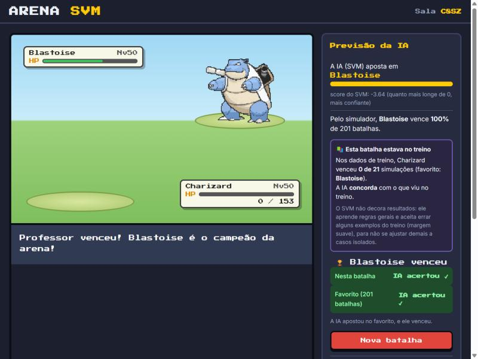

# Arena de Personagens: prevendo batalhas Pokémon com SVM

Projeto da disciplina **Inteligência Artificial II** · Ciência da Computação · FIB
Professor: Ronaldo Cesar Dametto



## Problema
Em jogos de batalha, os jogadores escolhem personagens sem saber quem tem vantagem no confronto. Este projeto investiga
se é possível **prever o favorito de uma batalha 1 contra 1** usando apenas as características dos personagens
(atributos e tipos), e **o que realmente decide** o resultado.

**Pergunta de investigação:** um classificador **SVM (Support Vector Machine)**, usando apenas atributos e tipos, consegue
prever o vencedor de batalhas entre **Pokémon que nunca viu no treino**, superando regras simples como "vence o mais
rápido" ou "vence o mais forte"?

**Aplicação prevista:** uma "arena" web em que duas pessoas escolhem (ou sorteiam) um Pokémon de qualquer geração e o
sistema prevê o favorito, mostrando a confiança da previsão.

## Integrantes e responsabilidades
| Integrante | Responsabilidade principal |
|---|---|
| Luan Carlos de Souza Ferreira | Dados e análise exploratória (EDA) |
| Gustavo de Carvalho Vieira | Pré-processamento, base de Pokémon e simulador de batalhas |
| Anthony Gabriel Schirato Lourenço | Experimentos e avaliação dos modelos |
| Lucas Miguel Moreno Rios | Protótipo web (arena para 2 jogadores) |
| Alceu Ferreira dos Santos Neto | Comunicação, resumo expandido, vídeo e materiais |

## Dados
| Arquivo | Origem | Licença |
|---|---|---|
| `data/raw/pokeapi/*.csv` | [PokéAPI](https://github.com/PokeAPI/pokeapi), pasta `data/v2/csv`: atributos, tipos, gerações e tabela de eficácia de tipos | BSD-3-Clause |
| `data/processed/pokemon.csv` | Gerado por `src/montar_base.py`: 1.242 Pokémon jogáveis das gerações 1–9 | derivado do PokéAPI |
| `data/processed/batalhas.csv` | Gerado por `src/gerar_batalhas.py`: 40.000 confrontos com **golpes reais**, cada um simulado 21 vezes | gerado pelo grupo |
| `data/processed/batalhas_golpes_simples.csv` | Mesmos confrontos com golpes genéricos (versão 1), para comparação | gerado pelo grupo |

**Por que um dataset de batalhas próprio?** O dataset público mais usado (*Pokemon Challenge*, Kaggle) cobre só as gerações
1–6, e as batalhas dele foram geradas por um "algoritmo próprio" sem regras documentadas. O nosso simulador
(`src/simulador.py`) usa a **fórmula de dano dos jogos principais** e os **golpes que cada Pokémon realmente aprende**
(poder, precisão, prioridade, acertos múltiplos, dano de retorno, roubo de vida, queda de atributos), escolhendo a cada
turno o golpe de maior dano esperado. As simplificações (sem habilidades, itens, status ou trocas) estão no topo do arquivo.

**Variável-alvo:** `a_vence` (1 se o Pokémon A venceu a maioria das 21 simulações).

**Divisão treino/teste (sem vazamento):** treino com batalhas só entre Pokémon das gerações 1–6 e teste só entre Pokémon das
gerações 7–9. Nenhum Pokémon aparece nos dois conjuntos.

## Técnica
SVM (`sklearn.svm.SVC`, kernel RBF) com padronização (`StandardScaler`) dentro de um `Pipeline`. Features: diferença dos 6
atributos (A − B) e o multiplicador de tipo do melhor golpe de cada lado (em log2).

## Estrutura
```
arena-svm/
├── data/
│   ├── raw/pokeapi/          # CSVs originais do PokéAPI
│   └── processed/            # pokemon.csv e batalhas.csv (gerados)
├── src/
│   ├── montar_base.py        # PokéAPI -> pokemon.csv
│   ├── simulador.py          # regras da batalha (fórmula de dano)
│   ├── gerar_batalhas.py     # pokemon.csv -> batalhas.csv (seed 42)
│   ├── features.py           # features da batalha (atributos, tipos e golpes)
│   └── batalhar.py           # escolha dois Pokémon: previsão do SVM + simulação narrada
├── notebooks/
│   ├── 01_pipeline_duelo_svm.ipynb   # Checkpoint 1: EDA, baselines, SVM e métricas (ponta a ponta)
│   ├── 02_experimentos_svm.ipynb     # Checkpoint 2: experimentos E1–E5, erros e conclusões
│   └── 03_e6_comparacao_knn.ipynb    # E6: comparação com KNN e Regressão Logística, e efeito da escala
├── modelos/                  # modelos treinados (.joblib)
└── docs/                     # resumo expandido, referências, diário de IA, guia do checkpoint
```

## Como executar
Requisitos: Python 3.11 ou superior (testado no 3.12). As versões das bibliotecas estão fixadas no `requirements.txt` porque o modelo salvo depende da versão do scikit-learn.
```bash
python -m venv .venv
.venv\Scripts\activate          # Windows  (Linux/Mac: source .venv/bin/activate)
pip install -r requirements.txt

python src/montar_base.py       # opcional: o resultado já está versionado
python src/gerar_batalhas.py    # opcional: cerca de 1 min, mesmo resultado com a seed 42
```
Para batalhar dois Pokémon no terminal (escolha de geração, sorteio e batalha narrada):
```bash
python src/batalhar.py                     # modo interativo
python src/batalhar.py charizard blastoise
python src/batalhar.py --aleatorio 1 9     # sorteia A da geração 1 e B da geração 9
```
Depois, abra os notebooks em `notebooks/` (VS Code ou Jupyter) e execute todas as células (01: cerca de 1 min; 02: cerca de 5 min).

**Parâmetros principais:** `SEED = 42`; nível 50; 21 simulações por confronto; 30.000 confrontos de treino, 6.000 de teste
e 4.000 mistos; modelo final: SVM RBF com `C = 10` e `gamma = 0,05` (escolhidos no E3) e 15 features.

## Resultados preliminares (Checkpoint 1)
Teste com 6.000 batalhas entre Pokémon das gerações 7–9, nunca vistos no treino:

| Modelo | Acurácia | F1 | ROC-AUC |
|---|---|---|---|
| Classe majoritária | 0,510 | 0,000 | 0,500 |
| Vence o mais rápido | 0,678 | 0,675 | 0,713 |
| Vence o maior Total | 0,806 | 0,802 | 0,898 |
| Regressão Logística | 0,856 | 0,853 | 0,936 |
| **SVM RBF (padrão)** | **0,866** | **0,863** | **0,935** |

Com os golpes genéricos da versão 1 do simulador, o mesmo SVM chegava a 0,921. A queda mostra que o modelo ainda não
sabe quais golpes cada Pokémon aprende (ex.: erra Pikachu × Gyarados, que o Pikachu vence com Volt Tackle). Incluir
features de golpes é o experimento E2.

## Arena: jogo para dois jogadores
**Jogue online: https://arena-svm.onrender.com** · crie uma sala e mande o link para outra pessoa, de qualquer lugar.
A hospedagem é gratuita (Render): depois de um tempo sem acessos, o primeiro carregamento pode levar cerca de 1 minuto.

Aplicação web em `app/`: cada jogador escolhe (ou sorteia na roleta) um Pokémon de qualquer geração, a IA mostra quem
ela acha que vence, e a batalha é animada com os sprites dos jogos.

1. Dê dois cliques em `jogar.bat` (ou rode `.venv\Scripts\python app\servidor.py`).
2. Clique em **Criar sala**. Aparece um código (ex.: `PK7Q`) e um link.
3. O segundo jogador, **na mesma rede Wi-Fi**, abre o link no celular ou no computador (ou digita o código).
4. Cada um escolhe o Pokémon e clica em **Pronto!**. A batalha aparece para os dois.

**Laboratório (construtor de personagem):** em `/laboratorio` (https://arena-svm.onrender.com/laboratorio), a pessoa
monta um personagem (tipos e os 6 atributos), escolhe um adversário e vê ao vivo em quem a IA aposta, junto com um
**gráfico 2D da fronteira de decisão**: um corte do modelo real, variando duas diferenças de atributos e mantendo as
outras 13 variáveis. Personagens criados lutam com golpes genéricos dos seus tipos.

**Por que a IA apostou assim?** Durante a batalha, o painel lateral explica a previsão com os conceitos do SVM
(`app/explicacao.py`): a posição da batalha em relação à **fronteira de decisão e à margem** (score), o **peso de cada
fator** nesta batalha (estimado neutralizando cada grupo de features), os valores que o modelo comparou e os
**vetores de suporte** (batalhas do treino) que mais influenciaram a decisão. Uma página para validar os sprites de todos
os Pokémon fica em `http://localhost:5000/static/galeria.html`.

Na primeira vez, o Windows pode perguntar sobre o firewall: permita o acesso em **redes privadas**. Os sprites são
carregados do repositório [PokeAPI/sprites](https://github.com/PokeAPI/sprites), então é preciso internet.

## Experimentos (Checkpoint 2)
Notebook `notebooks/02_experimentos_svm.ipynb` · guia em `docs/guia_checkpoint2.md`.

| Experimento | Hipótese (registrada em 20/10) | Resultado |
|---|---|---|
| E1: kernel linear × polinomial × RBF | RBF supera o linear | Confirmada, mas fraca: 85,6% → 86,6% |
| E2: features dos golpes reais | Recupera a queda causada pelos golpes reais | Confirmada: **86,6% → 92,6%** |
| E3: ajuste de C e gamma (validação nas gerações 5–6) | Ganho pequeno | Sem ganho: 92,6% → 92,6% |
| E4: divisão aleatória × por geração | A divisão aleatória infla o resultado | Refutada: 92,5% × 92,6% (features relativas, sem identidade do Pokémon) |
| E6: SVM × KNN × Regressão Logística, com e sem padronização | O SVM supera os dois, por pouco; KNN e SVM pioram sem padronizar | Confirmada: SVM 92,6%, Logística 91,8%, KNN 91,1%. Sem padronizar, o KNN cai para 81,5% |
| E5: análise de erros | | Erros concentrados em confrontos decididos pela sorte e em duelos de nocaute em 1 golpe |

**Modelo final (v2):** SVM RBF, 15 features, **92,6%** de acurácia e ROC-AUC 0,977 no teste, salvo em
`modelos/svm_duelo_v2.joblib` e usado pela demo `src/batalhar.py`.

## Limitações conhecidas
- O simulador é mais simples que o jogo: não tem habilidades, itens, golpes de status, trocas nem estratégia. O modelo
  aprende as regras **do simulador**, e não serve para prever partidas competitivas reais.
- O modelo erra 7,3% dos favoritos no teste; o erro sobe para 31% em confrontos equilibrados e 13% em duelos de nocaute
  em 1 golpe. Uma batalha isolada também depende de sorte.
- As variáveis de golpes usam a mesma fórmula do simulador, e a "confiança" mostrada na arena não é uma probabilidade
  calibrada.
- A arena funciona em rede local e precisa de internet para carregar os sprites.

## Tecnologias
Python 3.12 · scikit-learn (SVM) · pandas · NumPy · Matplotlib · Flask · HTML, CSS e JavaScript (sem frameworks) ·
dados do PokéAPI.

## Materiais do projeto
| Material | Link |
|---|---|
| Resumo expandido (Jornada Científica) | [PDF](docs/jornada/Resumo_Jornada_2026_Arena_SVM.pdf) |
| Model Card | [PDF](docs/entregas/Model_Card.pdf) |
| Ficha de experimentos | [PDF](docs/entregas/Ficha_de_Experimentos.pdf) |
| Folder | [PDF](docs/entregas/folder/Folder_Arena_SVM.pdf) |
| Instagram | [@arena.svm](https://www.instagram.com/arena.svm/) · [cards e legenda](docs/entregas/instagram) |
| Jogo online | https://arena-svm.onrender.com |
| Vídeo demonstrativo | [roteiro](docs/entregas/video/roteiro_video.md) · link do vídeo: a publicar |
| Referências e artigos | [referências](docs/referencias.md) · [artigos](docs/artigos) |

## Uso de IA
O uso de ferramentas de IA está registrado em `docs/diario_ia.md`.

---
Pokémon e os nomes dos personagens são marcas registradas da Nintendo, Game Freak e Creatures. Projeto acadêmico, sem fins
comerciais.
